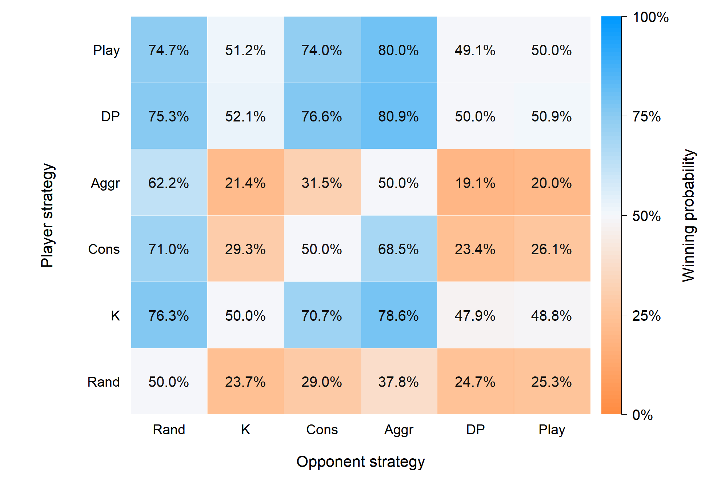

# Mexico Dice Game

When should a player stop rolling to maximise their chance of winning the game? This group project studies Mexico with two to eight players. We use dynamic programming to compute optimal play and Monte Carlo simulations to compare different strategies.

## Game rules

Each roll uses two fair six-sided dice. The larger die gives the tens digit, so a 2 and a 5 score 52. Scores are ranked numerically. The first player may roll up to three times, and the number of rolls they use sets the limit for everyone else in that round. Each reroll replaces the previous score.

The player with the lowest score is eliminated. The highest scorer starts the next round, and the remaining players follow in clockwise order. Ties for lowest or highest are settled by a roll-off. If everyone ties, the round restarts with the same first player.

## Strategies and results

- **Optimal play.** Each player chooses whether to stop or reroll to maximise their probability of winning the whole game, assuming the other players do the same.
- **Fixed-K.** A player stops on a score of at least K. For each number of players remaining, we select the K with the highest worst-case win rate averaged across starting positions. After an elimination, the player uses the K selected for the smaller game.

  | Players remaining | 2–4 | 5–6 | 7–8 |
  |---|---:|---:|---:|
  | Stopping threshold K | 52 | 51 | 44 |

- **Playable.** The opening player uses the optimal opening thresholds. Later players follow the Conservative rule until the chosen switch point, then use the Aggressive rule. We selected `Playable_r2` from the switch points tested. With two players left, the second player has only the opening score to match.

The head-to-head comparison starts each game with four players using each strategy. A cell gives the proportion of games won by someone using the row strategy, over 10,000 games per pair.



## Reproduce the figures

The plotting scripts use R. To install their dependencies, run this in R:

```r
install.packages(c("ggplot2", "dplyr", "scales", "data.table", "arrow"))
```

Start in the repository root. For example, to reproduce the Fixed-K figure from the supplied CSV files:

```sh
cd analysis
Rscript plot_fixed_k_wcwr.R
```

Run the other plotting scripts from `analysis/` as well. They write new PNGs to that working directory. The figures used in the report are collected in `figures/`.

| Script in `analysis/` | What it produces |
|---|---|
| `plot_optimal_win_probabilities.R` | First-player advantage for 2–8 players and win probabilities by starting position in a five-player game |
| `plot_fixed_k_wcwr.R` | Worst-case win rate for each candidate K and player count |
| `plot_dice_distributions.R` | Cumulative distributions of the best score across one, two or three rolls |
| `plot_playable_strategy.R` | Win rates by switch point and a comparison of the selected Playable strategy with three alternatives |
| `plot_four_strategy_win_rates.R` | Win rates for Random, Conservative, Aggressive and Optimal in eight-player games with two players per strategy |
| `plot_head_to_head.R` | Pairwise win-rate matrix for all six strategies |
| `plot_dice_and_reroll_advantage.R` | First-player advantage as the number of dice or permitted rerolls changes |

## Code and data

`src/optimal_dp.py` implements the optimal-play solver. `src/fixed_k.py` evaluates the candidate stopping thresholds and prints their worst-case win rates. `src/simulation.R` contains the shared R game and simulation functions.

| Location | Contents |
|---|---|
| `results/optimal_strategy_win_probabilities.csv` | Optimal-play win probabilities by player count and starting position |
| `results/wcwr/` | Fixed-K worst-case win rates for each player count and a summary of the best thresholds |
| `results/optimal_winning_strategy/` | Full state-by-state strategy tables for 2–7 players |
| `results/threshold/` | Compact stopping-threshold tables for 2–8 players |
| `docs/` | Reserved for the final report and presentation slides |

The full eight-player table, `optimal_winning_strategy_n8.parquet`, is omitted because it is over 100 MB. Its compact counterpart, `threshold_n8.parquet`, is included. The head-to-head and four-strategy simulations can therefore run directly with the supplied files.

To rebuild all strategy and threshold tables, run the following from the repository root:

```sh
python -m pip install pyarrow
python src/generate_optimal_winning_strategy.py
Rscript src/generate_thresholds.R
```